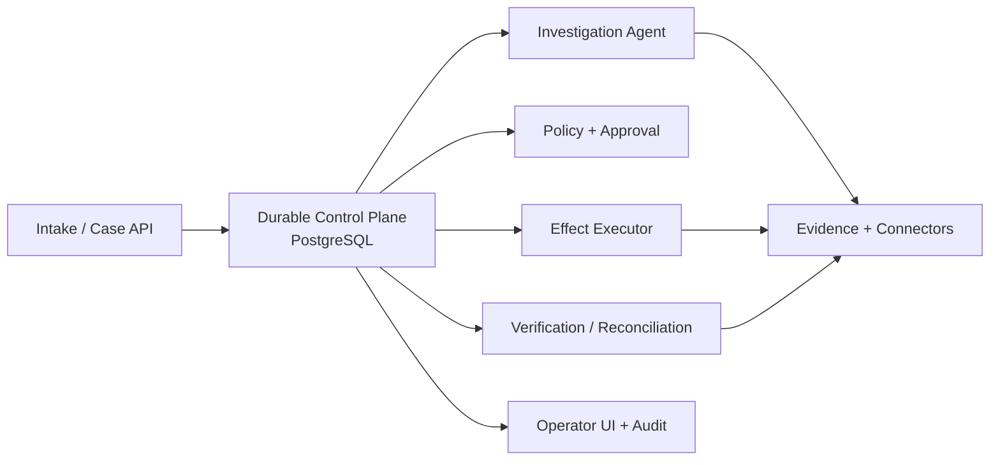

# Reliable AI Agents for Enterprise Workflows

[](https://github.com/yasuss/reliable-ai-agents-for-enterprise-workflows/actions/workflows/design-checks.yml)
[](LICENSE)

**An implementable architecture for AI agents that resolve real business exceptions
across SAP/ERP, supplier portals, email and spreadsheets — safely, over days, with
humans in the loop only where policy requires them.**

The reference case is an accounts-payable invoice exception: the invoice does not
match the purchase order, goods receipt or contract rate. An agent investigates,
proposes a correction, gets the right approval, asks the supplier for a credit, and
closes the case only when the ERP actually reconciles.

---

## The problem

Letting an LLM call SAP is easy. Completing a business outcome safely is not:

- **Reasoning is probabilistic.** The model can be wrong, or be manipulated by text in
  a supplier email.
- **External systems are unreliable.** A write can succeed while its response times out.
  A blind retry sends a second credit request or posts twice.
- **Many writes are not idempotent.** Browser portals and email have no idempotency keys.
- **Humans answer hours later.** By then the PO may have changed, and the approval no
  longer describes reality.
- **"Request sent" is not "money recovered".** HTTP 200 is not business completion.

Most agent stacks optimise for the first point. This architecture is built around the
other four.

## Design in one sentence

A **PostgreSQL-owned durable control plane** with a transactional outbox and persisted
timers, **bounded LLM investigation**, **policy-bound human approval**, a **semantic
effect ledger with reconciliation**, and **explicit business-postcondition
verification** — on a TypeScript / PostgreSQL / GCP stack, with Temporal kept as a
measured migration path rather than a day-one dependency.

## Core invariants

1. The workflow database never silently becomes the financial source of truth.
2. A model may **propose** an action; it can never **authorize** it.
3. An approval authorizes one **exact proposal version** — not "whatever the agent does next".
4. A timeout after an external write means **unknown**, not failed.
5. Cross-system exactly-once is not assumed: idempotency keys where available, **reconciliation** where not.
6. `200 OK`, "email sent" and "claim submitted" are not completion.
7. `COMPLETED` requires a **verified business postcondition**; partial recovery stays open.
8. Long waits are persisted state and timers — never an occupied worker.
9. Every consequential action is attributable to tenant, run, policy version, approver, effect and evidence.
10. A visible manual fallback is always better than a wrong or duplicate irreversible effect.

## Architecture at a glance



The design separates three kinds of semantics:

| Semantics | Owner | May be probabilistic? |
| --- | --- | --- |
| **Reasoning** — which evidence to read, hypotheses, proposed resolution | Investigation agent (LLM) | Yes, inside an allow-listed, read-only capability envelope |
| **Authority** — is this effect allowed, who must approve | Deterministic policy engine + authenticated humans | No |
| **Effects** — perform one identified business mutation, prove what happened | Effect executor + verifier | No |

Full design: [docs/architecture.md](docs/architecture.md) — system context, ownership
boundaries, domain model, lifecycle state machine, effect semantics, approval and
TOCTOU protection, verification, security, multi-tenancy, scaling, observability,
deployment and evolution path.

## One case, end to end

```text
invoice → PO → goods receipt → contract rate → discrepancy (+1 000 USD)
  → typed ProposedResolution (Zod-validated)
  → policy: REQUIRE_HUMAN_APPROVAL
  → reviewer approves the exact proposal fingerprint
  → re-read source versions (PO unchanged? ETag still valid?)
  → Effect: request supplier credit  ── timeout ──▶ UNKNOWN_EFFECT_STATE
  → reconcile: claim already exists → CONFIRMED_APPLIED (no second request)
  → WAITING_EXTERNAL (days, no worker held, reminders by timer)
  → credit note observed + ERP reconciled → OUTCOME_VERIFIED → COMPLETED
```

A step-by-step version with the design reasoning at each point:
[docs/walkthrough.md](docs/walkthrough.md).

## Decisions and alternatives

Every major choice was compared against serious alternatives and has explicit
conditions under which it should be revisited.

| Decision | Chosen | Alternatives considered | Revisit when |
| --- | --- | --- | --- |
| [Durable orchestration](docs/decisions/ADR-0001-postgres-owned-control-plane.md) | PostgreSQL-owned state machine + outbox + timers | Temporal; managed cloud orchestrator; free-form durable agent loop; DBOS, Restate, Durable Task, Conductor, Trigger.dev | timer/replay/versioning code becomes a recurring incident source, or many workflow topologies and teams need a shared engine |
| [External effects](docs/decisions/ADR-0002-effect-ledger-and-reconciliation.md) | Semantic `Effect` / `EffectAttempt` ledger, reconcile before retry | Rely on queue/engine retries; claim exactly-once | never — required regardless of orchestrator |
| [Approvals](docs/decisions/ADR-0003-approval-fingerprint-and-revalidation.md) | Approval bound to proposal hash, target, amount, source revisions, policy version, expiry | Generic "continue" button; re-approve everything | — |
| [Authority](docs/decisions/ADR-0004-deterministic-policy-outside-the-llm.md) | Deterministic policy gate; LLM autonomy only inside investigation | Model decides when approval is needed | — |
| [Completion](docs/decisions/ADR-0005-verified-business-completion.md) | Workflow-specific verified postcondition; partial stays open | "Agent says done"; HTTP success | — |
| [Timers and dispatch](docs/decisions/ADR-0006-persisted-timers-and-outbox.md) | `next_wake_at` in PostgreSQL + transactional outbox; Cloud Tasks as wake-up hint | Long-scheduled Cloud Tasks; Kafka/Pub/Sub as canonical state | — |
| [Source of record](docs/decisions/ADR-0007-source-of-record-per-fact.md) | Authority per fact; workflow DB owns automation state only | Workflow DB as cached truth | — |

Deliberately **not** in the first version: a universal workflow DSL, event-sourcing
every business entity, Kafka as canonical state, multi-agent orchestration, global
exactly-once claims, always-on approval for every write, Temporal by default.
Full comparison and challenge reviews: [docs/alternatives.md](docs/alternatives.md).

## Failure modes it is designed for

| Scenario | Behaviour |
| --- | --- |
| SAP write commits, response times out | `UNKNOWN_EFFECT_STATE` → reconcile by business key → retry only if proven not applied |
| Queue delivers the same job twice | Stable effect identity and durable step state suppress the second business effect |
| Approved 12 hours later, PO changed | Revalidation fails → approval invalidated → back to investigation / re-approval |
| Supplier email says "ignore policy and pay" | External content is untrusted evidence; the model only proposes; policy owns effects |
| Credit requested but never arrives | Submission is intermediate; run waits, reminds, escalates — never "done" |
| Deploy or crash during a multi-day wait | Wait is persisted state; any worker resumes from the last committed transition |
| Two runs race on the same invoice | Case business key, resource claim, unique effect key, ETag check, DB constraint |

22 adversarial scenarios with outcomes and residual risks:
[docs/failure-modes.md](docs/failure-modes.md).

## Executable design checks

The core failure semantics are modelled in a small stdlib-only harness that runs in CI:

```bash
python verification/design_checks.py
```

It verifies that a run survives restart without repeating work, an ambiguous write is
reconciled instead of retried, an absent effect may be retried, a stale approval is
rejected, `COMPLETED` is unreachable before verification, the policy gate blocks
unapproved effects, duplicate delivery creates no second effect, and the architecture
documents contain the required security and provenance controls.
It is a model of the semantics, not a connector test. See
[verification/README.md](verification/README.md) and the requirement-to-check
traceability in [docs/requirements.md](docs/requirements.md).

## Reference stack

| Layer | Choice |
| --- | --- |
| Operator UI | Next.js / React |
| API, control plane, workers | TypeScript, Fastify, Kysely, Zod |
| Durable state, outbox, timers, audit metadata | Cloud SQL for PostgreSQL (HA) |
| Evidence blobs | Google Cloud Storage |
| Dispatch / backpressure | Cloud Tasks, Cloud Scheduler |
| Compute | Cloud Run; isolated browser-execution pool |
| Secrets | Secret Manager / customer connection vault |
| Observability | Datadog traces, metrics, logs; SIEM audit export |

Why this stack and not a dedicated workflow engine:
[ADR-0001](docs/decisions/ADR-0001-postgres-owned-control-plane.md).

## Implementing it

- **TypeScript reference path** — follow [docs/architecture.md](docs/architecture.md)
  and the staged rollout in [docs/rollout-and-migration.md](docs/rollout-and-migration.md):
  read-only shadow mode → approval-required effects → policy-tiered autonomy → more workflows.
- **Python path with ARR** — the reliability semantics (exact approval, effect receipts,
  postcondition verification, durable restart) are already implemented and tested in
  [Agent Reliability Runtime](https://github.com/yasuss/agent-reliability-runtime).
  Its v2 extension ports map one-to-one onto this architecture; the ports this design
  additionally needs (reconciliation, durable timers, source revisions, capability
  registry) are defined in ARR v2 as planned interfaces. Component-by-component mapping:
  [docs/implementing-with-arr.md](docs/implementing-with-arr.md).

## Repository map

```text
docs/
  architecture.md            full system design
  requirements.md            constraints, quality goals, acceptance criteria, traceability
  walkthrough.md             one case end to end, plus design Q&A
  alternatives.md            architecture options and challenge reviews
  decisions/                 architecture decision records (ADR-0001 … ADR-0007)
  failure-modes.md           adversarial scenarios and residual risks
  rollout-and-migration.md   risks, staged rollout, kill switches, Temporal migration
  open-questions.md          facts deliberately not assumed, and how each is resolved
  implementing-with-arr.md   mapping to Agent Reliability Runtime v2 ports
  references.md              primary sources behind load-bearing decisions
verification/
  design_checks.py           executable model of the failure semantics
```

## Scope

This repository is an architecture specification with executable design checks.
It contains no production connectors and makes no claim about any specific company's
internal systems. Connector-specific behaviour (SAP endpoints, portals, email
providers) must be validated with contract and sandbox tests during implementation —
see [docs/open-questions.md](docs/open-questions.md).

## License

[Apache License 2.0](LICENSE).
