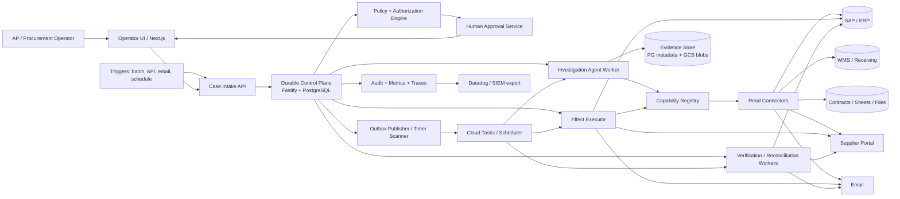
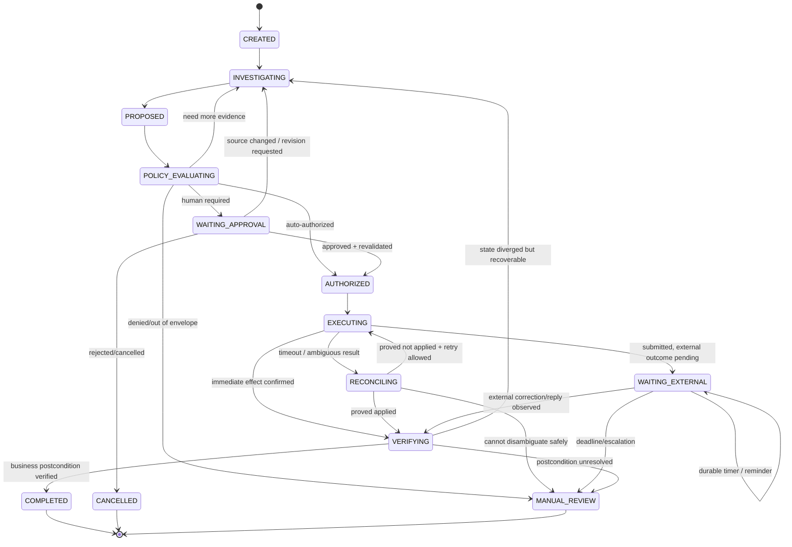
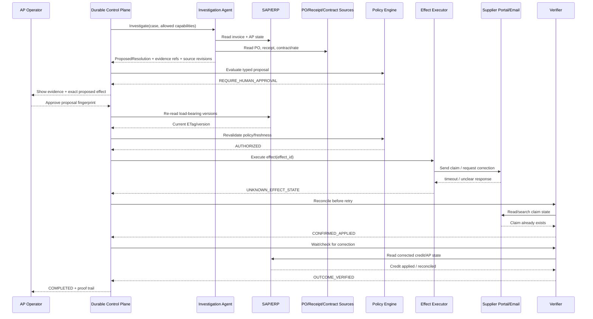

# Architecture — Durable AI Agents for Enterprise Operational Exceptions

> Companion documents: [requirements](requirements.md) · [walkthrough](walkthrough.md) · [alternatives](alternatives.md) · [decisions](decisions/) · [failure modes](failure-modes.md) · [rollout and migration](rollout-and-migration.md) · [open questions](open-questions.md) · [implementing with ARR](implementing-with-arr.md)

## 1. Goal

Resolve an enterprise operational exception end to end across ERP, supplier portal, email and spreadsheets while preserving:

- source-of-record discipline;
- durable multi-day execution;
- bounded agent autonomy;
- deterministic authorization;
- safe external side effects;
- human approval where required;
- recovery from partial failure;
- proof that the promised business outcome actually completed.

The primary example is an AP supplier-invoice exception, but the runtime primitives are intentionally reusable.

---

## 2. System context



### Logical component view

At the logical level the system consists of eight components:

1. Intake + Case API
2. Durable Control Plane
3. Investigation Agent
4. Evidence + Source Connectors
5. Policy + Approval
6. Effect Executor
7. Verification/Reconciliation
8. Operator UI + Audit

PostgreSQL, object storage and Cloud Tasks are supporting infrastructure, not separate logical components.

---

## 3. Ownership boundaries

### Business systems of record

Authority is per fact, not per vendor:

- **SAP/ERP** — PO, invoice/accounting record, payment block/status, posting and vendor-reference facts when the customer defines SAP as owner.
- **WMS / receiving system** — goods receipt, delivery acceptance or service receipt when that is where the operational fact originates.
- **Contract/rate source** — contract repository, spreadsheet, SAP pricing, TMS or signed document according to customer process.
- **Supplier portal** — supplier-side claim/correction/credit status where relevant.
- **Email** — communication evidence; normally not authoritative financial state.

### Workflow database

PostgreSQL is authoritative only for automation state:

- Case and Run lifecycle;
- checkpoints and timers;
- policy decisions;
- approvals;
- evidence references and immutable snapshots;
- proposed effects;
- effect attempts/receipts;
- verification results;
- audit events.

A cached business fact carries at least:

`tenant_id, source_system, source_object_type, source_object_id, observed_at, source_version/etag/hash, payload_hash, evidence_id`

No cached value silently supersedes the source system.

---

## 4. Core domain model

```text
Tenant
  └─ WorkflowDefinition(versioned)
      └─ Case(business_key)
          └─ Run(workflow_version, state, version, next_wake_at)
              ├─ RunStep / Checkpoint
              ├─ Evidence[]
              ├─ ProposedResolution[]
              │   └─ ProposedEffect[]
              ├─ PolicyDecision[]
              ├─ HumanRequest
              │   └─ ApprovalDecision
              ├─ Effect
              │   └─ EffectAttempt[]
              │       └─ EffectReceipt?
              ├─ Verification[]
              ├─ Timer / Deadline[]
              └─ AuditEvent[]
```

### Important identity fields

**Case business key** prevents two independently created cases from resolving the same business exception without awareness of each other. Example:

`tenant + workflow_type + supplier + invoice_id + accounting_entity`

**Effect ID** is stable across transport retries. It represents one intended business mutation, not one HTTP request.

**Effect business key** binds semantic uniqueness, for example:

`tenant + action_type + source_object + proposal_version`

**Approval fingerprint** binds the approval to:

- proposal hash;
- exact tool/capability;
- target system/object;
- intended mutation/amount;
- evidence/source revision set;
- policy version;
- reviewer authority context;
- expiry.

An approval is not a generic “continue” button.

---

## 5. Durable lifecycle



The worker that advances a state is disposable. The state is not.

---

## 6. Durable control plane implementation

### PostgreSQL state machine

`runs` contains current state, optimistic version, workflow-definition version, deadlines and `next_wake_at`.

Every transition executes in a DB transaction:

1. lock/check current run version;
2. validate legal transition;
3. append `audit_event` / `run_transition`;
4. write the new current state/version;
5. write an outbox event for the next runnable unit;
6. commit.

The queue message is therefore a **wake-up hint**, not the source of truth.

### Transactional outbox

An outbox publisher sends committed runnable work to Cloud Tasks. If publishing fails, the row remains and is retried. If publishing succeeds but acknowledgement is lost, duplicate dispatch is harmless because workers claim/check the durable step/effect state before doing work.

### Timers

Do not schedule a Cloud Task 60 days into the future.

Persist:

`next_wake_at`, `deadline_at`, `timer_kind`, `run_id`

A small timer scanner, triggered periodically, claims due rows using a queue-like PostgreSQL pattern and dispatches short-lived work. Parked cases consume storage, not worker compute.

### Leases

For runnable units:

`status, lease_owner, lease_until, attempt_no`

Workers claim a bounded batch. If a worker dies, the lease expires and another worker can continue. Every step still checks its durable completion/effect state before executing.

---

## 7. Agent reasoning boundary

### The agent is allowed to decide

Inside `INVESTIGATING`, the LLM may:

- choose which allowed evidence source to inspect next;
- call read-only capabilities;
- extract/normalize records;
- compare invoice, PO, receipt and contract terms;
- form and test hypotheses;
- ask for missing evidence;
- propose a resolution;
- replan after a recoverable read/tool failure.

### The agent is not allowed to decide

The LLM does **not** own:

- whether a capability is authorized;
- whether approval is required by policy;
- whether the reviewer has authority;
- retry semantics for a consequential effect;
- terminal completion;
- tenant/credential scope;
- audit retention;
- budget/deadline invariants.

### Typed proposal contract

The agent exits the reasoning boundary with structured data, not an imperative command:

```ts
type ProposedResolution = {
  caseId: string;
  findingType: string;
  summary: string;
  evidenceRefs: string[];
  sourceRevisionSet: SourceRevision[];
  confidence: number;
  proposedEffects: ProposedEffect[];
  expectedBusinessPostcondition: Postcondition;
  unresolvedQuestions: string[];
};
```

The proposal is validated with Zod before policy evaluation.

---

## 8. Capability and connection boundary

A capability is typed and declares semantics the runtime can enforce:

```text
CapabilityDefinition
- capability_id / version
- read | write
- target_system_type
- input/output schema
- risk_class
- required_scopes
- supports_idempotency_key?
- supports_read_after_write?
- supports_version_precondition?
- side_effect_class
- verification_strategy
- timeout/retry policy
- browser/API executor type
```

Connections are tenant-scoped. The model never receives raw secrets.

The credential broker resolves a scoped credential only at execution time and only for the authorized capability/tenant. Browser sessions run in isolated sandboxes with constrained egress and recorded execution evidence appropriate to the customer's policy.

---

## 9. Policy and human approval

### Policy result

A deterministic policy engine evaluates the typed proposal and returns one of:

- `AUTO_AUTHORIZE`
- `REQUIRE_HUMAN_APPROVAL`
- `NEED_MORE_EVIDENCE`
- `DENY`

Inputs include:

- capability/risk class;
- amount/materiality;
- evidence completeness/conflict;
- customer-specific rules;
- source freshness;
- reviewer/role requirements;
- action reversibility;
- confidence threshold only where policy explicitly uses confidence.

The LLM may provide facts used by policy only after those facts are validated against evidence; it cannot output “approval not required” as authority.

### Approval UX

The reviewer sees:

- what the agent found;
- the minimum source evidence needed to inspect the finding;
- exact proposed change and financial amount;
- why policy requires them;
- source versions/freshness;
- expected business outcome;
- what happens on approve/reject;
- expiry/SLA.

Approval creates an immutable `ApprovalDecision` with reviewer identity, authority scope, timestamp and the approval fingerprint.

### Approval after 12 hours: TOCTOU protection

Before an approved effect executes:

1. re-read all load-bearing source records or their version tokens;
2. compare against the `sourceRevisionSet` bound to approval;
3. re-run policy if any relevant fact/policy changed;
4. if material state changed, invalidate the old approval and return to investigation/reapproval.

Where SAP exposes an ETag, send `If-Match` on the mutation. A stale ETag becomes a controlled concurrency conflict, not a silent overwrite.

---

## 10. External effects: the most important reliability boundary

### Effect state

```text
PLANNED
→ AUTHORIZED
→ DISPATCHED
→ EXECUTING
→ CONFIRMED_APPLIED | CONFIRMED_NOT_APPLIED | UNKNOWN_EFFECT_STATE
→ VERIFIED | NEEDS_RECONCILIATION | FAILED_FINAL
```

`Effect` contains semantic intent; `EffectAttempt` contains transport attempts.

### If the target supports idempotency

Use stable `effect_id` / provider-supported idempotency key across retries.

For SAP endpoints that support repeatable requests, use the supported request identity semantics. For resources with ETags, use the approved version in `If-Match`.

### If the target does not support idempotency

Default algorithm:

1. obtain stable business key;
2. read-before-write when it can prove the intended effect is absent;
3. persist `EffectAttempt(INTENT_RECORDED)` before calling target;
4. execute once;
5. on clear success, persist receipt and verify;
6. on clear safe failure before side effect, apply bounded retry policy;
7. on timeout/connection loss after dispatch, set `UNKNOWN_EFFECT_STATE`;
8. reconcile target state using business key/read-back/search;
9. retry only after evidence proves the effect did not happen;
10. if it cannot be proven safely, route to `NEEDS_RECONCILIATION` / human.

**Timeout is not evidence of failure.**

### Duplicate supplier email

- deterministic effect/business key for the intended message;
- provider idempotency/message ID if available;
- outbox marks one semantic send intent;
- a duplicate worker delivery sees the existing effect/receipt and does not send again;
- if send result is ambiguous, reconcile via provider/search/sent-mail evidence before another send.

### Browser portal write

The browser adapter records enough pre/post state to distinguish:

- no submit attempted;
- submit confirmed;
- submit possibly happened but response/navigation failed.

Only the first is automatically retryable. The third is reconciliation-first.

---

## 11. Verification and business completion

The completion contract belongs to the workflow definition.

For the main AP recovery/reconciliation example:

```text
POTENTIAL_EXCEPTION
→ VALIDATED_EXCEPTION
→ ACTION_DECIDED
→ ACTION_APPROVED
→ ACTION_SUBMITTED
→ WAITING_EXTERNAL
→ CORRECTION_OBSERVED
→ ERP_RECONCILED
→ OUTCOME_VERIFIED
→ COMPLETED
```

Examples:

- SAP returned 200: not completion.
- Supplier email sent: not completion.
- Claim submitted: not completion.
- Credit note received: not necessarily completion.
- Credit/correction observed **and** the configured AP/ERP state reconciles: completion for this workflow.

`Verification` records:

- expected postcondition;
- authoritative sources checked;
- source versions/time;
- observed values;
- pass/fail/partial;
- evidence refs;
- verifier implementation/version.

Partial supplier recovery stays open with the remaining balance rather than being flattened into success.

---

## 12. AP invoice exception: end-to-end sequence



---

## 13. Concurrency and duplicate case protection

Two runs may discover the same invoice exception. Prevent double action at multiple layers:

1. intake dedupe by case/business key;
2. active resource claim for high-risk source objects;
3. unique semantic effect key;
4. source version/ETag check at execution;
5. read-after-write verification.

The DB constraint is the last deterministic guard even if two workers race.

---

## 14. Failure handling matrix

| Failure | Default behavior |
|---|---|
| LLM/provider transient error | bounded retry of reasoning step; no business effect yet |
| LLM malformed/unsupported proposal | schema reject; replan or human, never execute |
| Read API transient failure | bounded backoff retry |
| SAP write timeout after dispatch | `UNKNOWN_EFFECT_STATE` → reconcile; no blind retry |
| SAP ETag stale | re-investigate/re-policy/reapprove if material |
| Supplier portal UI changed before submit | classify adapter drift; capture evidence; repair/retry |
| Portal fails after possible submit | reconcile portal state before retry |
| Browser auth expired | pause connection; re-auth/refresh; preserve run; never weaken permission |
| Human approval delayed | parked durable state + SLA/escalation; no compute held |
| Human approves stale proposal | revalidation invalidates approval if source/policy changed |
| Duplicate queue delivery | worker sees completed/claimed step/effect; no duplicate business mutation |
| DB failover | transaction rolls back or commits atomically; leases expire; workers reconnect and resume |
| Supplier never responds | reminders/escalation/deadline; outcome remains open |
| Partial credit | record partial verified recovery; remaining amount stays unresolved |
| Irreconcilable ambiguous write | visible `NEEDS_RECONCILIATION`; operator owns next step |

---

## 15. Security and compliance architecture

### Identity and least privilege

- SSO/RBAC for humans.
- Tenant-scoped service identities/connections.
- Capability-specific scopes; separate read and write credentials where possible.
- Credential broker resolves secrets server-side; secrets never enter prompts.
- “On behalf of” attribution links agent action to initiating/principal context and, where needed, approver.

### Separation of duties

For financial actions, policy can require maker/checker constraints:

- policy author cannot self-approve a protected exception unless explicitly allowed;
- reviewer role/amount authority is validated server-side;
- approval and execution identities are recorded independently.

This is **SOX-control-ready behavior**, not a claim of SOX certification.

### Prompt-injection/tool safety

Treat email, PDFs, portal text and spreadsheet cells as untrusted data.

- external content cannot redefine system/tool policy;
- typed tool schemas and capability allowlists;
- policy gate immediately before consequential execution;
- least-privilege connector credentials;
- sanitize/escape content shown in approval UI;
- browser/download isolation and malware/file controls where needed;
- outbound network restrictions for browser sandboxes;
- model output is untrusted until schema/policy validation.

### Audit

Append-only audit event per material transition:

`who/what principal → intent → evidence refs → model/prompt/tool version → policy version/decision → approval → effect attempt → target receipt → verification → outcome`

Store a concise decision rationale and structured evidence, not hidden chain-of-thought.

For stronger tamper evidence, periodically hash-chain/anchor audit batches and export to customer SIEM according to contract/retention policy.

### Data minimization

Do not retain every raw browser/email payload forever. Keep:

- normalized facts required for replay/audit;
- hashes/provenance;
- minimal necessary artifacts;
- configurable retention/deletion;
- object-store lifecycle/archive for large evidence.

---

## 16. Multi-tenancy and scaling

### Tenant isolation

Every durable row and object key is tenant scoped. Defense in depth:

- tenant-aware repository layer / optional PostgreSQL RLS;
- tenant-scoped credentials and connector configs;
- per-tenant policy versions;
- queue/concurrency quotas;
- tenant-specific retention/export;
- no cross-tenant model context;
- hot-tenant rate limiting/fair scheduling.

### Workload shape

Initial sizing assumption, to be validated against pilot customer volumes: `10^3–10^5 cases/day across tenants`. The load profile matters more than the absolute number:

- many case creations;
- fewer actively reasoning runs;
- much fewer high-risk external effects;
- potentially very large parked `WAITING_FOR_HUMAN/EXTERNAL` population.

Parked runs cost database/object storage, not worker slots.

### Scaling levers

- partition Cloud Tasks queues by capability/risk/priority, not one queue per customer;
- tenant fair-share concurrency controls;
- separate worker pools for LLM work, API writes and browser sessions;
- browser-session concurrency caps;
- indexed `next_wake_at` timer scan;
- partition/archive audit/evidence by time/tenant as volume requires;
- read replicas for operator/reporting queries where safe;
- keep correctness-critical writes on primary.

Cloud Tasks is a dispatcher, not a business exactly-once mechanism.

---

## 17. Observability and product metrics

### Runtime metrics

- verified completion rate;
- duplicate-effect rate (target: zero, alert on any);
- ambiguous-effect rate;
- reconciliation success/manual rate;
- human intervention rate;
- approval age / SLA breaches;
- p95 active execution latency by capability;
- external-wait duration;
- retries by failure class;
- cost per verified completed case;
- browser drift/auth failure rate.

### Business/product metrics

- exception resolution cycle time;
- human touch time per case;
- touchless percentage by risk tier;
- recovered/prevented loss where applicable;
- operator correction/override rate;
- false positive/invalid claim rate;
- percentage of process owners who keep automation enabled after rollout.

Do not optimize “number of automated actions” at the expense of correct verified outcomes.

---

## 18. Deployment shape

A pragmatic first production deployment:

- **Next.js** operator UI;
- **Fastify** + **Kysely** (TypeScript) API/control-plane services on GCP/Cloud Run;
- **Cloud SQL PostgreSQL HA** for durable state/effect/audit metadata;
- **GCS** for larger evidence artifacts;
- **Cloud Tasks** for short-horizon dispatch/backpressure;
- **Cloud Scheduler** (or equivalent) to trigger timer scanning;
- isolated browser-execution pool/sandbox;
- Secret Manager / customer connection vault;
- Datadog traces/metrics/logs and SIEM audit export.

No request or worker remains alive for a 12-hour approval. No queue message is trusted as the canonical state.

---

## 19. Evolution path

### Phase 1 — read-only investigation

- file/API intake;
- source provenance;
- agent investigation;
- human validates finding;
- no production writes.

### Phase 2 — approved write-back

- typed capabilities;
- deterministic policy;
- exact approval fingerprint;
- effect ledger;
- idempotent/reconciled SAP/supplier actions;
- read-after-write verification.

### Phase 3 — exception-led autonomy

- auto-execute explicitly pre-authorized low-risk effects;
- only ambiguous/material/out-of-policy cases interrupt humans;
- operator UX prioritizes genuine exceptions.

### Phase 4 — reuse across workflows

Extract a primitive into the shared runtime only after two real workflows need the same semantics, or the failure is costly enough that centralizing it already pays.

### Phase 5 — workflow-engine reevaluation

Use production evidence to evaluate Temporal/DBOS/Restate/etc. If owned orchestration semantics become the bottleneck, migrate the **control-flow durability** while retaining the same source-authority, policy, effect-ledger and verification contracts.

Those contracts are more durable than the orchestrator implementation.
