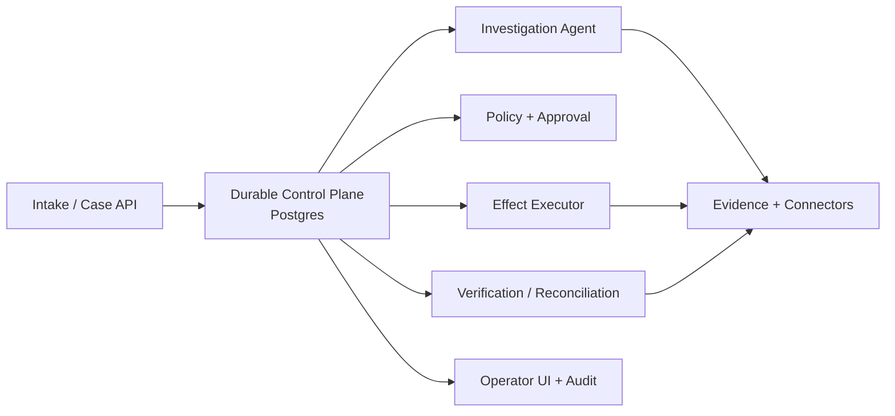

# Walkthrough

A compact tour of the design: one accounts-payable exception from intake to verified
completion, the reasoning at each step, and answers to the questions this kind of
system always raises. The full specification is in [architecture.md](architecture.md).

## 1. Questions that shape the design

Before choosing components, the design answers:

1. Which system owns each fact, and each write?
2. Which actions may run automatically, and which need approval?
3. What exact business postcondition means "done"?
4. Can a run wait hours or days? (Yes.)
5. Which integrations are API-based and which are browser-only?
6. What is the worst failure? (A wrong or duplicate irreversible effect.)
7. Which compliance and separation-of-duties rules apply?
8. What scale should the design assume?

**Reference case:** an AP supplier-invoice mismatch. The invoice, PO, goods receipt and
contract evidence are compared; the discrepancy is validated; approval is obtained where
required; a supplier correction or credit is requested; permitted state is written back;
and the AP/ERP record is verified as reconciled. Sending the request is not completion.

## 2. Four invariants

1. Source systems remain the business source of truth.
2. The LLM can propose but cannot grant itself authority.
3. External effects are not assumed exactly-once — retries are idempotent or reconciled.
4. A run completes only after the business postcondition is verified.

Almost every later trade-off follows from these four.

## 3. Eight components



Infrastructure behind the boxes:

- TypeScript / Fastify services;
- PostgreSQL for durable state and the transactional outbox;
- Cloud Tasks only for dispatch and backpressure;
- GCS for large evidence artifacts;
- a separate browser-execution pool;
- Datadog and SIEM export for observability and audit.

## 4. One case, end to end

### A. Intake

Create a `Case` with a stable business key, for example supplier + invoice + legal entity.
Start a versioned `Run`.

### B. Investigation

The control plane enters `INVESTIGATING`. The agent uses **read-only, allow-listed
capabilities** to fetch invoice, PO, receipt and contract/rate evidence. Every observed
fact keeps its provenance and source version (ETag or hash).

The agent returns a typed `ProposedResolution`, not a write command.

### C. Policy

A deterministic policy engine evaluates the proposal and returns
`AUTO_AUTHORIZE | REQUIRE_HUMAN_APPROVAL | NEED_MORE_EVIDENCE | DENY`.
High-value financial changes, contradictory evidence and out-of-policy actions normally
require a human.

### D. Approval

The reviewer sees the exact proposed change and the evidence behind it. The approval is
bound to a hash of the action and parameters, amount, source revisions, policy version
and expiry.

### E. Revalidate before executing

If approval took 12 hours, the load-bearing records are re-read. If the PO changed, the
approval is stale and cannot be reused. Where SAP supports ETags, the write carries
`If-Match`.

### F. Execute the effect

A stable `Effect` is recorded before the external call. The effect is the semantic
business intent; HTTP or browser retries are only `EffectAttempt`s.

### G. Reconcile ambiguity

If the SAP or portal action succeeds but the response times out, the effect becomes
`UNKNOWN_EFFECT_STATE`. No blind retry: read back or search by business key, and retry
only when the first effect provably did not happen.

### H. Verify the business outcome

A supplier email or claim submission is an intermediate step. The run stays open until
the correction or credit appears and AP/ERP reconciles. Only then
`OUTCOME_VERIFIED → COMPLETED`.

## 5. The central reliability point

> Exactly-once across SAP, email and browser automation is not promised. What is
> promised is exactly one **semantic intent** in the ledger, safe retries where the
> target supports idempotency, and explicit reconciliation when the outcome is ambiguous.

```text
Effect(intent)
  ├─ Attempt #1 -> timeout
  └─ state = UNKNOWN
       ↓
    reconcile target
       ├─ effect exists -> CONFIRMED_APPLIED
       ├─ effect absent -> retry allowed
       └─ cannot prove  -> NEEDS_RECONCILIATION
```

## 6. Long-running durability

A run may wait days for approval or a supplier reply, but no worker waits. PostgreSQL
stores `state` and `next_wake_at`; a timer scanner dispatches due work. Cloud Tasks is a
delivery mechanism, not canonical workflow state. A crash or deploy simply means another
worker claims the next durable step. The transactional outbox ensures that "DB committed
but queue publish failed" never loses progress.

## 7. Security and enterprise controls

- tenant isolation on every durable object;
- scoped credentials and least privilege, separate read and write permissions;
- SSO/RBAC and server-side reviewer authority;
- separation of duties (maker/checker) for financial actions;
- secrets resolved server-side, never placed in prompts;
- supplier email, portal and document content treated as untrusted data;
- typed tools and a policy gate at the effect boundary;
- append-only, tamper-evident audit linking evidence → decision → approval → effect → verification;
- retention, data minimization and GDPR controls.

The system *supports* SOX-governed customer controls; it does not claim to be SOX compliant.

## 8. Scale and performance

Sizing assumption: roughly 10³–10⁵ cases/day across tenants. The important shape is many
parked runs, fewer active reasoning jobs, and far fewer high-risk writes and browser
sessions.

- capability-specific worker pools;
- tenant fairness and quotas;
- separate browser concurrency limits;
- indexed due timers;
- partitioned and archived evidence and audit when volume requires;
- model and provider rate limits and budgets.

The UI returns the case immediately and always shows what the run is doing or waiting for,
the owner, the deadline and the next transition.

## 9. Why not Temporal (yet)

Temporal is the strongest alternative: durable timers, replay, signals and mature workflow
semantics. It does not remove the effect ledger — external activities are not exactly-once
either. For the first AP slice the existing TypeScript / PostgreSQL / GCP stack is enough;
the move to Temporal is triggered by measured evidence that owned timer, replay or
versioning logic has become a recurring engineering or incident burden.
See [ADR-0001](decisions/ADR-0001-postgres-owned-control-plane.md).

## 10. Metrics

System: verified completion rate; duplicate and ambiguous effect rate; human intervention
and approval age; reconciliation and manual fallback rate; p95 active execution latency;
cost per verified completed case.

Business: resolution cycle time; human touch time; touchless rate by risk tier; recovered
or prevented loss; operator correction and override rate; whether process owners keep
automation enabled.

## 11. Design Q&A

**SAP write succeeded but the response timed out.**
`UNKNOWN_EFFECT_STATE`; reconcile by business key or read-back; retry only after proving
the effect was not applied.

**The supplier portal UI changed.**
Adapter drift. Capture DOM, screenshot and error context, stop at the capability boundary,
repair and version the adapter. If the submit may already have happened, reconcile first.

**A human approved 12 hours later and the PO changed.**
The approval covered a specific proposal and source revision. Revalidation detects the
change, invalidates the approval, and the run replans or asks for re-approval.

**The agent sent the same supplier email twice.**
That is a defect the design prevents: a stable semantic effect key plus outbox and receipt
suppress a second send on duplicate delivery; an ambiguous provider result is reconciled
before any retry.

**The browser session lost authentication.**
Pause the connection and the run, refresh or re-authenticate through the connection
boundary. Never weaken security or ask the LLM to work around authentication.

**Prove why the agent made the decision.**
Structured evidence lineage, source versions, the validated proposal, model/prompt/tool
versions, policy decision, reviewer decision, effect receipt and final verification.
Hidden chain-of-thought is not needed and not stored.

**The business wants 90% automation.**
Move stable low-risk actions into explicit pre-authorized policy tiers based on observed
quality. The policy boundary stays; the model never self-authorizes.

**A new customer runs a different ERP.**
A new connection/capability adapter and mappings. Case, Run, Approval, Effect and
Verification semantics stay unchanged.

**Why PostgreSQL and not Kafka?**
The core problem is durable state with transactions, queries, approvals and semantic
effect uniqueness — not high-throughput streaming. Kafka or Pub/Sub can carry events but
must not replace canonical run and effect state.

**Two agents work on the same invoice.**
Case business-key deduplication, an active resource claim, a unique effect key and a
source-version check. The database constraint is the last guard against a race.

## 12. The design in one line

Reasoning stays flexible; authority, side effects and completion are deterministic. That
allows aggressive automation without turning an LLM or a retrying queue into the financial
system of record.
